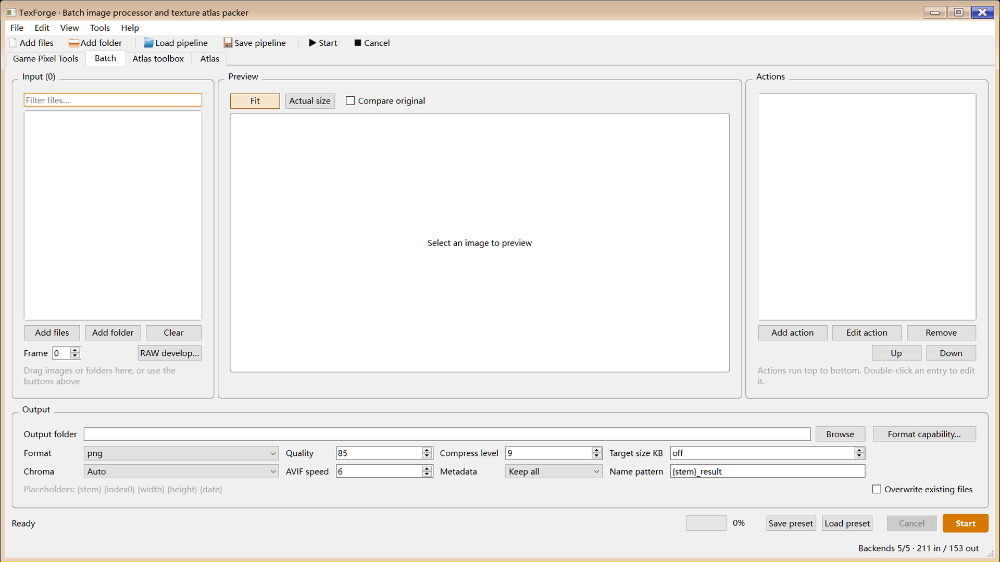
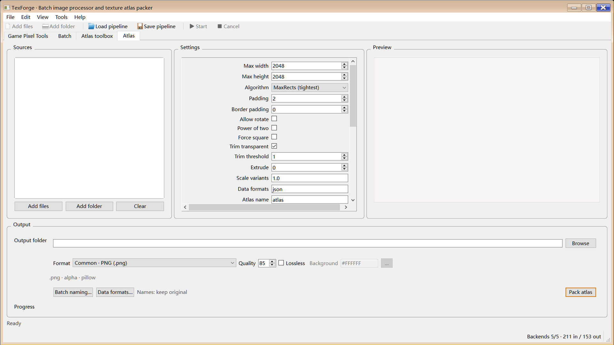
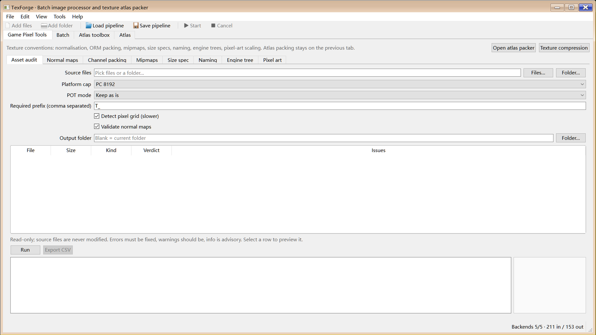

# TexForge

**统一图像批处理与纹理图集打包工具** · **Unified batch image processor & texture atlas packer**

[](https://apps.microsoft.com/detail/9p7wpkn0t5cn?cid=DevShareMCLPCS&hl=zh-CN&gl=HK)
[](https://apps.microsoft.com/detail/9p7wpkn0t5cn?cid=DevShareMCLPCS&hl=zh-CN&gl=HK)
[](https://lijiannan1241.github.io/TexForge/zh/download.html)
[](https://lijiannan1241.github.io/TexForge/)
[](LICENSE)

[](https://apps.microsoft.com/detail/9p7wpkn0t5cn?cid=DevShareMCLPCS&hl=zh-CN&gl=HK)

> 已在 Microsoft Store 上架 · Available on Microsoft Store
> [中文官网](https://lijiannan1241.github.io/TexForge/zh/) · [English site](https://lijiannan1241.github.io/TexForge/en/) · [博客 Blog](https://lijiannan1241.github.io/TexForge/zh/blog/) · [常见问答 FAQ](https://lijiannan1241.github.io/TexForge/zh/faq.html)

---

## 中文

TexForge 是面向游戏与数字内容团队的 Windows 桌面工具：把**批量图像处理**与**纹理图集打包**放进同一套管线。图形界面用于调试与预览，命令行用于脚本与 CI，两者共享同一份动作与预设。

### 核心能力

| 能力 | 说明 |
|---|---|
| **113 个批处理动作** | 缩放、裁剪、旋转、水印、格式转换、压缩、元数据读写，按顺序叠加执行 |
| **69 种图集图片格式** | Unity、Godot、Unreal、Cocos、Phaser、PixiJS、Spine、LibGDX、Egret、LayaAir、微信小游戏及通用 JSON/XML/plist/CSS/CSV |
| **24 种引擎数据格式** | 图集描述文件与引擎目录树（Unity / Unreal / Godot / Cocos / 自定义） |
| **法线贴图与通道打包** | 高度图生成法线、ORM / RMA 通道打包、Y 轴方向切换 |
| **Mipmap 与平台限制** | 生成 Mipmap 链并按移动端 / 桌面端尺寸上限校验 |
| **资产审查** | 命名、尺寸、重复文件、配对缺失检查，输出 CSV / JSON 报告 |
| **四个工作区** | 游戏像素工具 · 批量处理 · 图集工具箱 · 图集打包 |

### 安装

从 [Microsoft Store](https://apps.microsoft.com/detail/9p7wpkn0t5cn?cid=DevShareMCLPCS&hl=zh-CN&gl=HK) 安装，支持 Windows 10 / 11（x64）与自动更新。

### 命令行

安装包内含 `texforge-cli`，与图形界面共享预设：

```bash
texforge-cli --help
texforge-cli batch --preset ui-slices --input ./art --output ./build/art
```

### 隐私

TexForge 完全在本机运行：**不上传图片、不收集个人信息、不包含遥测 / 广告 / 追踪 SDK**。详见[隐私政策](https://lijiannan1241.github.io/TexForge/zh/faq.html#privacy)。

---

## English

TexForge is a Windows desktop tool for game and digital content teams that puts **batch image processing** and **texture atlas packing** into one pipeline. The GUI is for tuning and previewing; the CLI is for scripts and CI. Both share the same actions and presets.

### Highlights

| Capability | Details |
|---|---|
| **113 batch actions** | Resize, crop, rotate, watermark, convert, compress, edit metadata — stacked and run in order |
| **69 atlas formats** | Unity, Godot, Unreal, Cocos, Phaser, PixiJS, Spine, LibGDX, Egret, LayaAir, WeChat mini games, plus generic JSON/XML/plist/CSS/CSV |
| **24 engine data formats** | Atlas descriptors and folder trees for Unity / Unreal / Godot / Cocos / custom |
| **Normal maps & channel packing** | Height-to-normal generation, ORM / RMA packing, Y-axis switch |
| **Mipmaps & platform limits** | Mip chain generation with mobile and desktop size validation |
| **Asset audits** | Naming, dimensions, duplicates and missing pairs, with CSV / JSON reports |
| **Four workspaces** | Game pixel tools · Batch · Atlas toolbox · Atlas |

### Install

Get it from [Microsoft Store](https://apps.microsoft.com/detail/9p7wpkn0t5cn?cid=DevShareMCLPCS&hl=zh-CN&gl=HK) for Windows 10 / 11 (x64), with automatic updates.

### CLI

The package ships `texforge-cli`, sharing presets with the GUI:

```bash
texforge-cli --help
texforge-cli batch --preset ui-slices --input ./art --output ./build/art
```

### Privacy

TexForge runs entirely on your machine: **no image uploads, no personal data collection, no telemetry, advertising or tracking SDKs**. See the [privacy policy](https://lijiannan1241.github.io/TexForge/en/faq.html#privacy).

---

## Screenshots

| Batch workspace | Atlas packing |
|---|---|
|  |  |

| Game pixel tools | Atlas toolbox |
|---|---|
|  |  |

## Repository

This repository hosts the official product site published with GitHub Pages:

- Site source: `index.html`, `zh/`, `en/`, `assets/`, `sitemap.xml`, `robots.txt`, `llms.txt`
- Generator: `tools/gen_site.py` + `tools/site_content.py` (run `python tools/gen_site.py` to rebuild)

## Site pages

| Page | 中文 | English |
|---|---|---|
| Home | `zh/index.html` | `en/index.html` |
| Features | `zh/features.html` | `en/features.html` |
| Trailer | `zh/trailer.html` | `en/trailer.html` |
| How it works | `zh/how-it-works.html` | `en/how-it-works.html` |
| FAQ | `zh/faq.html` | `en/faq.html` |
| Download | `zh/download.html` | `en/download.html` |
| Blog | `zh/blog/` | `en/blog/` |

Every page carries the Microsoft Store badge and purchase link (top bar, header, in-page CTA, footer).

## How to update and upload

```bash
# 1. edit content (never edit the generated HTML by hand)
vim tools/site_content.py          # text, FAQ, trailer chapters, feature copy
vim tools/gen_site.py              # layout and template changes

# 2. rebuild all pages, sitemap, robots and llms.txt
python tools/gen_site.py

# 3. optional: regenerate the trailer poster
python tools/make_trailer_poster.py

# 4. commit and push — GitHub Pages rebuilds automatically
git add -A
git commit -m "Update site content"
git push origin main
```

Pages settings: branch `main`, folder `/ (root)`. A push usually goes live in under a minute; `sitemap.xml` and `llms.txt` are regenerated by the same script.

## Links

- Microsoft Store: <https://apps.microsoft.com/detail/9p7wpkn0t5cn?cid=DevShareMCLPCS&hl=zh-CN&gl=HK>
- Chinese site: <https://lijiannan1241.github.io/TexForge/zh/>
- English site: <https://lijiannan1241.github.io/TexForge/en/>
- Trailer: <https://lijiannan1241.github.io/TexForge/zh/trailer.html>
- How it works: <https://lijiannan1241.github.io/TexForge/zh/how-it-works.html>
- Blog: <https://lijiannan1241.github.io/TexForge/zh/blog/>
- FAQ: <https://lijiannan1241.github.io/TexForge/zh/faq.html>
- Contact: cdljn2022@gmail.com

## License

See [LICENSE](LICENSE).
