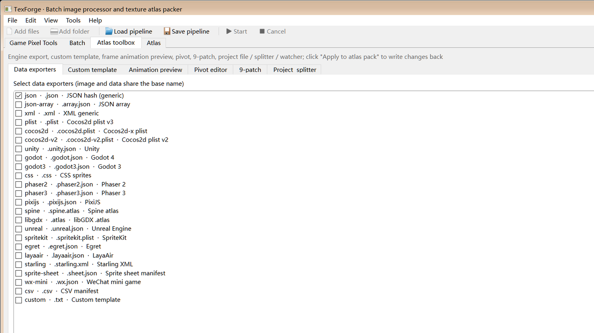

# TexForge — Texture Atlas Packer & Batch Image Processor for Game Devs (Windows)

**统一图像批处理与纹理图集打包工具** · **Unified batch image processor & texture atlas packer**

[](https://apps.microsoft.com/store/detail/9P7WPKN0T5CN?cid=DevShareMCLPCS)

[](https://apps.microsoft.com/store/detail/9P7WPKN0T5CN?cid=DevShareMCLPCS) [](https://apps.microsoft.com/store/detail/9P7WPKN0T5CN?cid=DevShareMCLPCS) [](https://lijiannan1241.github.io/TexForge/zh/download.html) [](https://lijiannan1241.github.io/TexForge/) [](LICENSE)

把一整天的贴图返工，压缩成一次点击。TexForge 把**批量图像处理**与**纹理图集打包**合并进同一条管线——界面里调预览，命令行里进 CI，两者共用同一份预设。

Turn a day of sprite busywork into one click. TexForge unifies **batch image processing** and **texture atlas packing** in one pipeline — tune in the GUI, ship via CLI, share the same preset, and keep every image on your machine.

> **TexForge is a Windows texture atlas packer and batch image processor for game developers.** It turns folders of sprites into engine-ready sprite sheets and atlases (Unity, Godot, Unreal, Cocos and more), generates normal maps and packs PBR channels, and runs fully offline with no uploads, no telemetry and no sign-up.

> [官网 · Official site](https://lijiannan1241.github.io/TexForge/) · [中文](https://lijiannan1241.github.io/TexForge/zh/) · [English](https://lijiannan1241.github.io/TexForge/en/) · [下载 Download](https://apps.microsoft.com/store/detail/9P7WPKN0T5CN?cid=DevShareMCLPCS) · [博客 Blog](https://lijiannan1241.github.io/TexForge/zh/blog/) · [常见问答 FAQ](https://lijiannan1241.github.io/TexForge/zh/faq.html)

---

## 为什么需要 TexForge / Why TexForge

游戏美术和独立开发者最常见的真相：**真正拖慢进度的不是画画，而是把画好的图整理进引擎**。TexForge 就是为这件事而生。

| 你遇到的痛点 | 通常怎么做 | TexForge 怎么解决 |
|---|---|---|
| 几百张图要缩放、转格式、加水印 | 逐个手动改，或临时拼脚本 | 113 个批处理动作叠加成预设，一次跑完 |
| 打图集要装好几个软件 | 批处理用一个、打包用一个、导数据再换一个 | 4 个工作区 + 6 个处理后端，全在一个程序里 |
| Unity / Godot / Unreal / Cocos 格式不通 | 每个引擎重新导一遍 | 69 种图集格式 + 24 种引擎数据格式，一次配置多端导出 |
| ORM / RMA 通道顺序、法线 Y 轴老出错 | 材质在引擎里发灰，来回返工 | 一键通道打包、法线 Y 轴切换、尺寸与 Mipmap 校验 |
| 在线工具要上传素材 | 商业或未发布素材不敢传云端 | 完全本地运行，无上传、无遥测、无广告追踪 |
| 美术调好的参数进不了 CI | 手动重复操作，容易漏 | GUI 与 CLI 共用 JSON 预设 / 流水线，脚本与 CI 直接复用 |

---

## 功能特性 / Features

### 核心数字 / At a glance

> **113** 个批处理动作 · **69** 种图集图片格式 · **24** 种引擎数据格式 · **6** 个处理后端 · **100%** 本地运行（无遥测）

### 核心能力 / Highlights

| 能力 Capability | 说明 Details |
|---|---|
| **113 个批处理动作** | 缩放、裁剪、旋转、水印、格式转换、压缩、元数据读写，按顺序叠加执行 |
| **69 种图集图片格式** | Unity、Godot、Unreal、Cocos、Phaser、PixiJS、Spine、LibGDX、Egret、LayaAir、微信小游戏，以及通用 JSON/XML/plist/CSS/CSV |
| **24 种引擎数据格式** | 图集描述文件与引擎目录树（Unity / Unreal / Godot / Cocos / 自定义） |
| **法线贴图与通道打包** | 高度图生成法线、ORM / RMA 通道打包、Y 轴方向切换 |
| **Mipmap 与平台限制** | 生成 Mipmap 链，并按移动端 / 桌面端尺寸上限校验 |
| **资产审查** | 命名、尺寸、重复文件、配对缺失检查，输出 CSV / JSON 报告 |
| **四个工作区** | 游戏像素工具 · 批量处理 · 图集工具箱 · 图集打包 |
| **中英双语界面** | 中文 / English 一键切换，GUI 与 CLI 共享预设 |

### 支持的引擎与格式 / Supported engines & formats

TexForge exports **Unity sprite atlases**, **Godot texture atlases**, Unreal Engine, Cocos Creator, Phaser, PixiJS, Spine, LibGDX, LayaAir, Egret, WeChat mini-game atlases, plus generic JSON / XML / plist / CSS / CSV sprite sheet data. It also works as a **normal map generator** and **offline image processor** for 2D, 2.5D and 3D game assets.

---

## 截图 / Screenshots

| 批处理工作区 Batch image processing | 图集打包 Sprite atlas packing |
|---|---|
|  |  |

| 游戏像素工具 Game pixel tools | 图集工具箱 Atlas toolbox |
|---|---|
|  |  |

---

## 快速开始 / Quick Start

**中文**：从安装到打出第一个图集，只需三步。

1. **安装**：从 [Microsoft Store](https://apps.microsoft.com/store/detail/9P7WPKN0T5CN?cid=DevShareMCLPCS) 安装（Windows 10/11 x64，自动更新，无需管理员权限）。独立安装器见[下载页](https://lijiannan1241.github.io/TexForge/zh/download.html)。
2. **配置并预览**：打开「图集打包」工作区 → 拖入 sprite 文件夹 → 选目标引擎（如 Unity / Godot）→ 设 padding、trim、多尺寸 → 预览布局与占用率。批处理工作区可把缩放/水印/转换等动作叠加成预设。
3. **导出**：点 Pack，得到图片 + 引擎描述文件（同名同目录，引擎直接识别）+ 结果报告。预设保存为 JSON，GUI 与 CLI 共用。

```bash
texforge-cli doctor                       # 环境与能力自检
texforge-cli batch --preset ui-slices --input ./art --output ./build/art
texforge-cli pack ./sprites -o ./atlas --max-size 2048 --data json,plist --scales 1,0.5
texforge-cli pipeline my.tfpipe.json      # 运行 GUI 保存的流水线
```

**English**: three steps from install to your first atlas.

1. **Install** from [Microsoft Store](https://apps.microsoft.com/store/detail/9P7WPKN0T5CN?cid=DevShareMCLPCS) (Windows 10/11 x64, auto-updates, no admin rights). Standalone installer on the [download page](https://lijiannan1241.github.io/TexForge/en/download.html).
2. **Configure & preview**: open the Atlas workspace → drop a sprite folder → pick a target engine (Unity / Godot…) → set padding, trimming and scales → preview layout and occupancy. In the Batch workspace, stack actions (resize / watermark / convert) into a preset.
3. **Export**: hit Pack to get images + engine descriptor (same name and folder, resolved immediately) + a result report. Presets are JSON files shared by GUI and CLI; the CLI runs the exact same pipeline in CI.

---

## 常见问题 / FAQ

### TexForge 会上传图片吗？需要联网或注册账号吗？ / Does TexForge upload images or require an account?

不会。TexForge 完全在本机运行，无上传、无遥测、无账号注册，可在离线环境使用。

No. TexForge runs entirely on your machine — no image uploads, no telemetry, no account, and it works offline.

### TexForge 支持哪些游戏引擎的图集格式？ / Which game engines does it support?

Unity、Godot、Unreal、Cocos、Phaser、PixiJS、Spine、LibGDX、LayaAir、Egret 与微信小游戏等，共 69 种图集图片格式与 24 种引擎数据格式。详见上方「支持的引擎与格式」一节。

### GUI 里调好的预设能在 CI 里复用吗？ / Can I reuse GUI presets in CI?

可以。GUI 与 CLI 共用同一份 JSON 预设 / 流水线文件，用 `texforge-cli pipeline` 即可在脚本和 CI 中运行完全相同的处理。

### 除了打图集，还能做什么？ / What else can it do besides atlas packing?

它还能作为批量图像处理工具（缩放、裁剪、水印、格式转换）、法线贴图生成器、ORM/RMA 通道打包工具和资产审查工具（命名/尺寸/重复/配对检查，输出 CSV/JSON 报告）。

---

## 隐私 / Privacy

TexForge 完全在本机运行：**不上传图片、不收集个人信息、不包含遥测 / 广告 / 追踪 SDK**。详见[隐私政策](https://lijiannan1241.github.io/TexForge/zh/faq.html#privacy)。

TexForge runs entirely on your machine: **no image uploads, no personal data collection, no telemetry, advertising or tracking SDKs**. See the [privacy policy](https://lijiannan1241.github.io/TexForge/en/faq.html#privacy).

---

## 链接 / Links

- 下载 Download (Microsoft Store): <https://apps.microsoft.com/store/detail/9P7WPKN0T5CN?cid=DevShareMCLPCS>
- 官网 Official site: <https://lijiannan1241.github.io/TexForge/>
- 中文站 Chinese: <https://lijiannan1241.github.io/TexForge/zh/>
- 英文站 English: <https://lijiannan1241.github.io/TexForge/en/>
- 预告片 Trailer: <https://lijiannan1241.github.io/TexForge/zh/trailer.html>
- 工作原理 How it works: <https://lijiannan1241.github.io/TexForge/zh/how-it-works.html>
- 博客 Blog: <https://lijiannan1241.github.io/TexForge/zh/blog/>
- FAQ: <https://lijiannan1241.github.io/TexForge/zh/faq.html>
- 联系 Contact: cdljn2022@gmail.com

---

## 关于本仓库 / About this repository

这个仓库托管用 GitHub Pages 发布的**官方产品网站**：

- 站点源码：`index.html`、`zh/`、`en/`、`assets/`、`sitemap.xml`、`robots.txt`、`llms.txt`
- 生成器：`tools/gen_site.py` + `tools/site_content.py`（运行 `python tools/gen_site.py` 重建）

| 页面 Page | 中文 | English |
|---|---|---|
| 首页 Home | `zh/index.html` | `en/index.html` |
| 功能 Features | `zh/features.html` | `en/features.html` |
| 预告片 Trailer | `zh/trailer.html` | `en/trailer.html` |
| 工作原理 How it works | `zh/how-it-works.html` | `en/how-it-works.html` |
| FAQ | `zh/faq.html` | `en/faq.html` |
| 下载 Download | `zh/download.html` | `en/download.html` |
| 博客 Blog | `zh/blog/` | `en/blog/` |

每个页面都带有 Microsoft Store 徽章与下载链接。

<details>
<summary>更新与上传 / How to update（维护者）</summary>

```bash
# 1. 编辑内容（不要手改生成的 HTML）
#    tools/site_content.py  文案 / FAQ / 预告片章节
#    tools/gen_site.py      布局与模板

# 2. 重建所有页面、sitemap、robots、llms.txt
python tools/gen_site.py

# 3. 提交推送，GitHub Pages 自动重新构建
git add -A
git commit -m "Update site content"
git push origin main
```

</details>

## 许可 / License

Licensed under the [Apache License 2.0](LICENSE).
